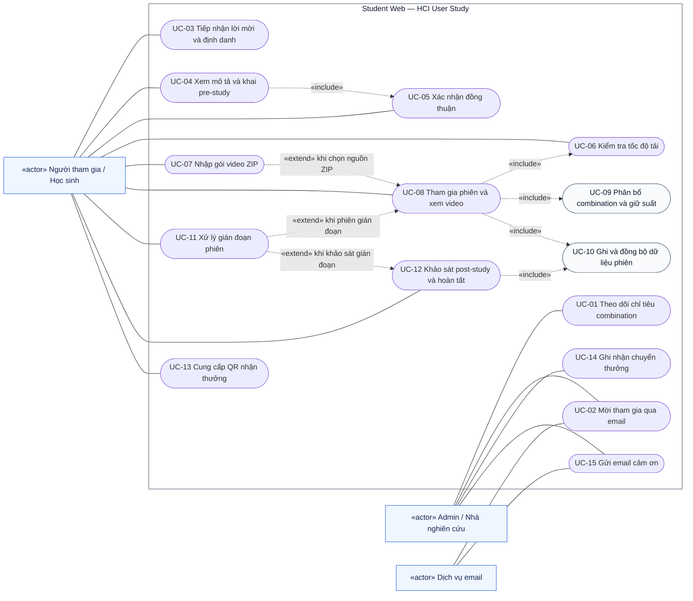

# Use-case diagram — Student Web cho HCI User Study

Nguồn: [requirement.md](requirement.md). Đặc tả: [use-case-specification.md](use-case-specification.md).

## 1. Cách đọc

Sơ đồ biểu diễn tác nhân và chức năng của hệ thống; các đường nối không biểu diễn thứ tự thực hiện. Bản này dùng `flowchart` với nút dạng bầu dục gần đúng để tương thích với các trình xem Mermaid phổ biến. Đây là cách biểu diễn use-case bằng quy ước UML trên flowchart, không phải cú pháp UML use-case gốc.

- Hình chữ nhật có nhãn `«actor»`: tác nhân bên ngoài hệ thống.
- Nút bo tròn: use-case; khung lớn: phạm vi Student Web.
- Đường liền: tác nhân tham gia use-case.
- `A → B «include»`: A bắt buộc sử dụng chức năng B; mũi tên hướng đến chức năng được dùng.
- `X → A «extend»`: X bổ sung hành vi cho A khi điều kiện ghi trên cạnh xảy ra.
- UC-09 và UC-10 là chức năng dùng chung, được gọi trong use-case khác; không phải màn hình riêng cho người dùng.

Mermaid hiện có cú pháp `usecase-beta` từ phiên bản 12.0.0, nhưng cú pháp này còn ở trạng thái beta. Tài liệu chọn flowchart để thuận tiện xem trong IDE khi chưa biết phiên bản Mermaid được cài. Tham khảo: [Mermaid — Use case diagrams](https://mermaid.js.org/syntax/usecase.html), [Mermaid — Flowcharts](https://mermaid.js.org/syntax/flowchart.html).

## 2. Sơ đồ tổng quan

Mã nguồn độc lập: [use-case-diagram.mmd](use-case-diagram.mmd).

## 3. Tác nhân

| Tác nhân | Trách nhiệm |
| --- | --- |
| Người tham gia / Học sinh | Truy cập lời mời, xác nhận đồng thuận, khai form, kiểm tra mạng, xem video, trả lời khảo sát và cung cấp QR nhận thưởng. |
| Admin / Nhà nghiên cứu | Theo dõi số người còn thiếu cho từng combination, gửi lời mời, ghi nhận trả thưởng và gửi email cảm ơn. |
| Dịch vụ email | Tiếp nhận yêu cầu gửi thư mời và thư cảm ơn, trả trạng thái gửi. Nhà cung cấp chưa được xác định. |

Database, bộ chọn combination, bộ ghi telemetry và tác vụ kiểm tra lock thuộc bên trong Student Web nên không được vẽ thành actor. Chưa đưa ngân hàng vào sơ đồ vì yêu cầu chưa xác định tích hợp chuyển tiền tự động.

## 4. Quan hệ và điểm mở rộng

| Use-case gốc | Quan hệ | Use-case liên quan | Ý nghĩa |
| --- | --- | --- | --- |
| UC-04 | include | UC-05 | Phải có đồng thuận hợp lệ trước khi nộp câu trả lời pre-study. Có thể dùng lại đồng thuận đúng phiên bản đã lưu. |
| UC-08 | include | UC-06 | Kiểm tra điều kiện tốc độ trước khi giữ suất và vào phiên. |
| UC-08 | include | UC-09 | Mỗi phiên phải có combination và suất được giữ hợp lệ. |
| UC-08 | include | UC-10 | Hoạt động xem video phải được ghi và đồng bộ dữ liệu. |
| UC-12 | include | UC-10 | Đồng bộ dữ liệu bắt buộc trước khi xác nhận hoàn tất. |
| UC-08 | extend bởi | UC-07 | Tại bước chuẩn bị video, nếu người tham gia chọn nguồn ZIP được hỗ trợ. Việc này không bỏ qua kiểm tra tốc độ. |
| UC-08 / UC-12 | extend bởi | UC-11 | Khi mất kết nối, đóng trang, hết hạn lock hoặc chủ động dừng phiên. |

Trình tự tham khảo của luồng thành công: admin mời → tiếp nhận và định danh → xem mô tả, đồng thuận, khai pre-study → kiểm tra mạng → phân bổ và giữ suất → chuẩn bị nguồn video → xem video và lưu dữ liệu → post-study, hoàn tất → cung cấp QR → admin ghi nhận chuyển thưởng → email cảm ơn. Trình tự trả thưởng và gửi cảm ơn là giả định bản nháp, xem GĐ-05 trong đặc tả.
